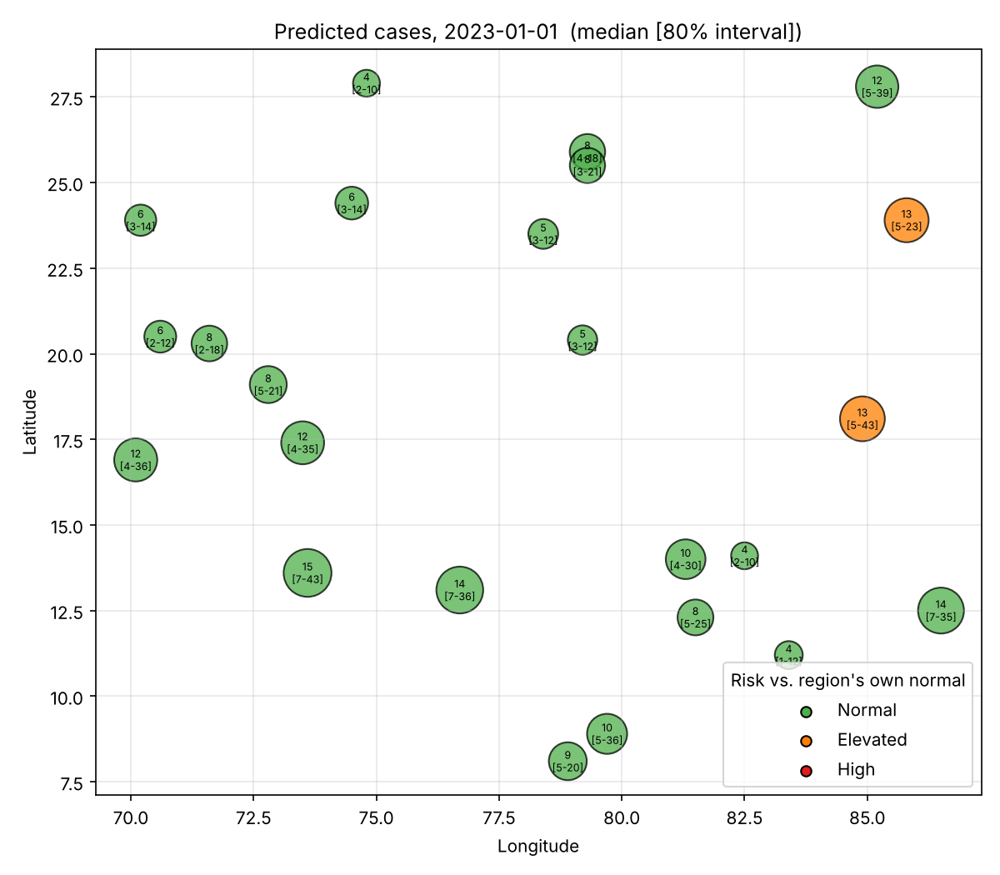
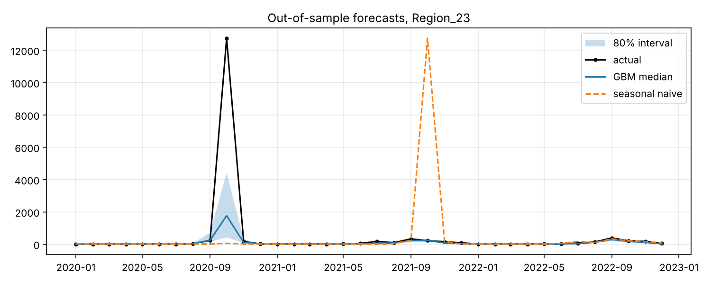
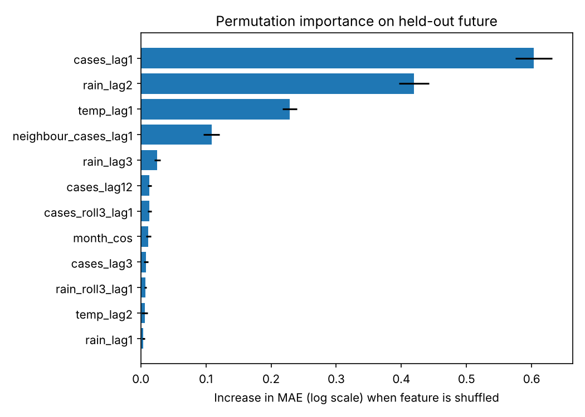

# Dengue / Vector-Borne Disease Risk Forecaster

Forecast **next month's dengue cases for each region** so a health team can decide where to send
resources first. Time-based validation, honest baselines, prediction intervals, explainability and a risk map.



## TL;DR (2-minute read)

| | |
|---|---|
| **Task** | One-step-ahead monthly case forecast per region, with an 80% prediction interval |
| **Inputs** | Monthly cases + rainfall + temperature (OpenDengue / InfoDengue + NASA POWER or ERA5) |
| **Validation** | Expanding-window, rolling-origin backtest. Train on the past, test on the future. Never a random split |
| **Baselines** | Last month's value; same month last year |
| **Models** | Ridge (regularised linear) -> Gradient boosting -> Quantile gradient boosting (10/50/90%) |
| **Metrics** | MAE, RMSE, **skill score** `1 - MAE_model / MAE_baseline`, interval coverage, pinball loss |
| **Statistics** | ADF stationarity test; deseasonalised rainfall-lag correlation with autocorrelation-corrected p-values |
| **Explainability** | Permutation importance on held-out future (+ SHAP if installed) and a risk map |

> ### Read this first: which numbers are real?
> The numbers below come from a **synthetic panel** (`src/dengue/synthetic.py`) where the climate to cases
> mechanism is known by construction. They prove the **pipeline works and is leak-free** (the planted 2-month
> rainfall lag is recovered, the model beats the baselines), **not** that it forecasts real dengue.
> Run `scripts/fetch_data.py` on OpenDengue + NASA POWER, re-run the pipeline and put your real numbers in the
> table at the bottom. Reviewers trust a smaller honest real-data result over a big synthetic one.

## Results on the synthetic panel (24 regions, 2010-2022, 3 yearly test folds: 2020-2022)

| Model | MAE (cases) | Skill vs seasonal-naive | Skill vs last-month |
|---|---|---|---|
| Last month | 100.6 | -9.4% | 0 |
| Seasonal naive (same month last year) | 92.0 | 0 | +8.6% |
| Ridge | 32.2 | +65.0% | +68.0% |
| Gradient boosting | 37.4 | +59.3% (95% block-bootstrap CI 33% to 73%) | +62.8% |

* Ridge beats boosting here because the simulator is (nearly) linear in log space. On real data, expect the
  opposite to be possible, which is why both are always reported.
* 80% prediction interval: **76.4% empirical coverage** (nominal 80%), slightly over-confident. Reported, not hidden.
* Rainfall lag: deseasonalised correlation peaks at **lag 2 months** (median r = 0.32; significant in 83% of
  regions) versus ~8% (chance level) at lags 0, 1 and 4.
* Stationarity: only 42% of regions are stationary in levels, but 88% after a 12-month seasonal difference.
  That motivates seasonal and lagged features instead of modelling raw levels.

 

## Why the methodology is trustworthy

1. **Time-based splits only.** `evaluate.rolling_origin_splits` trains on everything before each test year and
   asserts `train.max() < test.min()`. A random split would let the model see Jan-2021 and Mar-2021 while
   "predicting" Feb-2021.
2. **Leakage is unit-tested.** `tests/test_features.py` perturbs month *t*'s cases/rain/temperature by 7x and
   asserts that no feature in row *t* changes. Every feature uses `shift(>=1)`.
3. **Baselines first.** If a model can't beat last-month or same-month-last-year, it isn't worth shipping.
4. **Skill score with a confidence interval.** A moving-block bootstrap over *months* (keeps cross-region
   correlation and short-range autocorrelation) gives a 95% CI for the skill score.
5. **Honest correlation test.** Raw rainfall and cases both follow the monsoon, so naive correlation is inflated.
   We remove calendar-month means and correct p-values with Bretherton's effective sample size.
6. **Calibration is reported.** Interval coverage and pinball loss, not just "here is a band".

## Features (all lagged, per region)

| Group | Features | Rationale |
|---|---|---|
| Lagged cases | t-1, t-2, t-3, t-12, 3-month mean | Persistence and annual cycle |
| Rainfall | lag 1, 2, 3 months and 3-month sum | Breeding and incubation delay (~4-8 weeks) |
| Temperature | lag 1, 2 | Faster mosquito development and virus replication |
| Seasonality | sin/cos of month | Smooth annual cycle |
| Spatial | mean lagged cases of 3 nearest regions | Spill-over between neighbouring regions |

## Project structure

```
src/dengue/   data.py (load + validate + coverage report)   features.py   baselines.py   models.py
              evaluate.py (rolling origin, skill, bootstrap)   stats_tests.py   explain.py
              forecast.py (next-month forecast + risk tiers)   plots.py   synthetic.py
scripts/      run_pipeline.py (everything, one command)   fetch_data.py (real data builder)
tests/        leakage, calendar-lag, split, skill, planted-lag recovery, ADF, forecast shape
```

## Quick start

```bash
pip install -r requirements.txt
make demo        # synthetic data, no downloads  -> outputs/
make test
```

### Run on real data

1. Pick a dataset and **check coverage first** (need >= 60 months and >= 5 regions; the loader enforces this).
   Brazil (InfoDengue, weekly by municipality) and OpenDengue admin-1 data usually have the longest runs; Indian
   state-level public series are often short or annual, so verify before committing.
2. `python scripts/fetch_data.py --opendengue <csv> --country BRAZIL --centroids data/centroids.csv`
   (builds `data/panel.csv`; climate from the NASA POWER API). *This script follows the documented schemas but was not
   executed with network access when the repo was built. Test it on 2 regions first.*
3. `make real` and check `outputs/coverage_report.csv`, `metrics.csv`, `risk_map.png`.

Panel schema: `region, date, cases, rain_mm, temp_c, lat, lon` (one row per region-month).

## Limitations (say these in an interview)

* Monthly resolution loses the 4-week lag granularity; weekly data would model the breeding delay more precisely.
* Reported cases are not true cases: reporting delays, under-reporting and changing case definitions affect them,
  and OpenDengue weekly to monthly aggregation attributes partial weeks to the start month.
* Region centroids are a crude spatial representation; no population denominators, so risk tiers compare a region
  to **its own** recent normal rather than across regions.
* One-step-ahead only. Multi-month horizons need direct or recursive strategies and will be less accurate.
* Quantile intervals are not conformally calibrated; coverage should be checked per fold and region on real data.
* Correlation is not causation: lag correlations support, but do not prove, a mechanism.

## Your real-data results (fill in)

| Dataset | Regions x months | Test period | MAE model | MAE seasonal-naive | Skill (95% CI) | Interval coverage |
|---|---|---|---|---|---|---|
| _e.g. OpenDengue Brazil admin-1 + NASA POWER_ | | | | | | |

**Resume bullet:** *Built a monthly dengue-case forecaster using lagged climate features; outperformed a
seasonal-naive baseline by [X]% MAE under rolling-origin time-based validation; mapped regional risk with 80%
prediction intervals.*

## License
MIT
